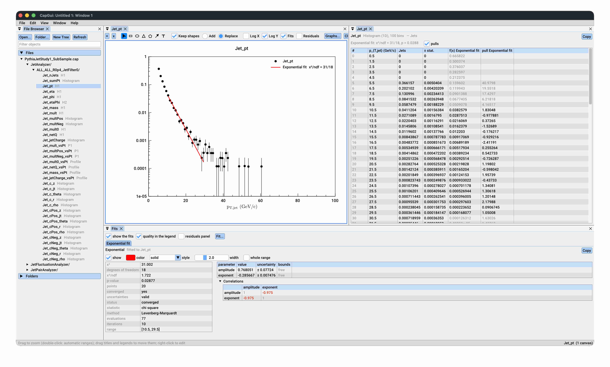

---
hide:
  - navigation
---

# Datum

**Datum** is a C++17 framework for simulating and analysing **correlation and fluctuation observables** in
proton&ndash;proton, proton&ndash;nucleus and nucleus&ndash;nucleus collisions, with its own data model, file format
and graphical interface. It computes predictions under the conditions of a measurement (the same acceptance, particle
species, event classes, efficiencies and detector resolution), from several event generators, and analyses data with
the same tools.

Datum 1.0 is the ninth version of the package formerly known as **CAP**, the Correlation Analysis Package, and the first
one published.

[Download Datum 1.0](download.md){ .md-button .md-button--primary }
[Read the manual](manual/index.md){ .md-button }
[API reference](api.md){ .md-button }

{ .screenshot }

-   :material-chart-bell-curve-cumulative: **Observables**

    ---

    Single-particle spectra; pair densities, cumulants $C_2$ and $R_2$; transverse-momentum correlators
    $\langle\Delta p_T\Delta p_T\rangle$, $P_2$, $G_2$; balance functions; $\nu_{\rm dyn}$ and higher moments;
    anisotropic flow; jets; global observables and event shapes. Every combination of event and particle filters
    is analysed in the same pass.

    [:octicons-arrow-right-24: Observables](manual/observables.md)

-   :material-atom: **Event generators**

    ---

    A simple generator (BasicEventGen), a thermal model (Therminator3), PYTHIA&nbsp;8, Herwig&nbsp;7, readers of EPOS
    and PHSD events, and a Glauber model of the collision geometry. A new generator works with every analysis.

    [:octicons-arrow-right-24: Generators](manual/generators.md)

-   :material-file-tree: **Workflows**

    ---

    Analyses are workflows of tasks described in XML, composed, checked and run with `RunDatum.py`, in up to three
    stages, in sub-samples, on a computer or on a Slurm cluster; detector efficiencies and smearing for performance
    studies.

    [:octicons-arrow-right-24: Running analyses](manual/workflows.md)

-   :material-database: **Its own data model**

    ---

    Histograms of any dimension, data points, tables, parameterised functions and fits, stored in a versioned binary
    format (`.datum`); ROOT is not needed. HEPData YAML import and export.

    [:octicons-arrow-right-24: Data and files](manual/data-files.md)

-   :material-monitor-dashboard: **DatumGui**

    ---

    A graphical interface to browse, draw, compare and fit histograms, functions and tables, in several windows, and
    to make figures, PDF books, PowerPoint presentations and LaTeX documents of them.

    [:octicons-arrow-right-24: DatumGui](manual/datumgui.md)

-   :material-table: **Tables of data**

    ---

    Text and CSV tables read in one click; columns used as X, Y, errors and covariance; plots, summary statistics and
    correlation matrices (Pearson, Spearman, Kendall).

    [:octicons-arrow-right-24: Tables of data](manual/tables.md)

## At a glance

| Datum 1.0 | |
|---|---|
| **Language** | C++17; Python 3 front ends for building and running |
| **Platforms** | macOS (Clang) and Linux (GCC) |
| **Build** | CMake, with the window of `BuildDatum.py` or from a shell |
| **Requires** | a C++17 compiler, CMake; ROOT is optional |
| **Optional** | PYTHIA 8, Herwig 7, FastJet, ROOT (conversion of `.root` files), LaTeX (typeset labels) |
| **License** | GNU Lesser General Public License, version 2.1 or later |
| **Source** | [github.com/cpruneau/Datum](https://github.com/cpruneau/Datum) |

!!! quote "How to cite Datum"
    C. Pruneau, V. Gonzalez and O. Sheibani, *Datum 1.0: a C++ framework for simulating and analysing correlation
    and fluctuation observables in high-energy collisions*, in preparation (2026).
    See [Credits](credits.md#how-to-cite) for the BibTeX entry.
