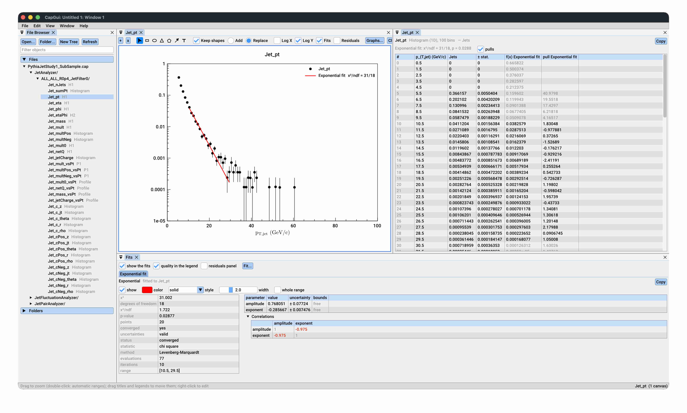
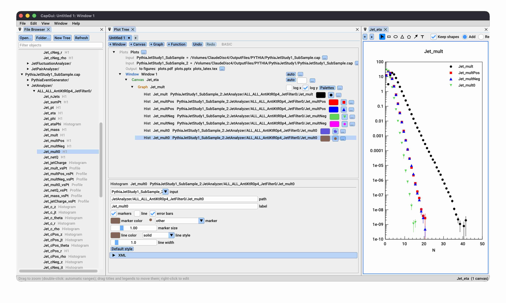

# DatumGui

DatumGui opens the files written by the jobs, draws their histograms, data points and functions, fits them, reads and
analyses tables, and makes figures and documents. It is built on Dear ImGui, GLFW and OpenGL, and uses no ROOT class.

```
bin/DatumGui [--basic | --edit] [plots.xml ...] [file.datum | table.csv | folder ...]
```

The BASIC mode starts from a new plot file, with the current folder (or the data folder of the preferences) in the
browser; the EDIT mode from the plot files given.

{ .screenshot }

## Windows and panes

DatumGui shows any number of **windows**, each with its own menu bar, all run by one application. It starts with one
window and a file browser; **Datum &gt; New Window** adds one, and DatumGui ends when its last window is closed.

A window holds **work panes**: file browsers, the plot tree and its inspector, canvases, tables, data panes and the
fit pane. Panes are docked side by side, stacked as tabs, dragged by their tab from one window to another or out into
a window of their own, and closed with the &times; of their tab; **View** shows or hides them. A plot file is shown in
a window of its own.

## Menus

Each command acts on the pane used last.

| Menu | |
|---|---|
| **Datum** | About, Preferences, New / Rename / Close Window, Quit |
| **File** | Data files and trees of the browser: New, New Data File, Open (Datum files and tables), Duplicate, Rename, Close, Save, Import and Export (ROOT, PDF, LaTeX, PowerPoint, HEPData) |
| **Plots** | Plot files: New, New From Data File, Open, Save, Add Graph, Add Function, Regroup, Move Up/Down, Export (PDF book, LaTeX, PowerPoint, named plots) |
| **Windows** | The windows of the plot file: New, Open, Duplicate, Rename, Format, Save, Export |
| **Canvas** | New, Open, Duplicate, Rename, Close, Format, Save, Save As (PDF, SVG, PNG, LaTeX, PowerPoint, XML plot file), Clear |
| **Edit** | Undo, Redo, Cut, Copy, Paste, Duplicate, Delete, Clear, Clear All |
| **View** | File browsers, plot browser, inspector, spreadsheets and data panes (the current one or all), style elements, fit results, toolbars, legends |
| **Maps** | Detector Maps |
| **Histograms** | Sum, Difference, Product, Ratio, Scale (with coefficients), Compare, Rebin, Fit, Show Data |
| **Functions** | New, Open, Save, Save As, Edit, Duplicate, Sum, Difference, Product, Ratio, Scale ([below](#functions)) |
| **Stat** | The tools of the table in use ([Tables of data](tables.md)) |
| **Help** | DatumGui help, keyboard shortcuts |

The context menus of the canvases (right-click) offer the same tools on the object under the mouse.

## The browser

The browser shows the data files opened (Datum files, and ROOT files when built with ROOT) and folders of the disk,
in which a Datum file opens when it is expanded and a table (`.txt`, `.dat`, `.csv`, ...) when it is clicked. A
filter selects objects by name. An object is drawn by clicking it (in the selected graph) or by dragging it onto a
graph or onto the plot tree; a folder adds all its objects. Objects can be gathered in new trees and saved as a new
Datum file.

## Graphs

- Drag a rectangle to zoom, along an axis to zoom on that axis; double-click for the automatic ranges.
- Drag the title, the axis titles and the legend to move them; right-click any of them, or an object, to edit it
  (ranges, scales, ticks, fonts, colours, markers, lines, uncertainties, palettes and contours of maps).
- **Compare** two histograms: their difference, ratio, or difference in units of its uncertainty, with $\chi^2$ and
  Kolmogorov&ndash;Smirnov tests. **Rebin** by a factor along every axis or one.
- Shapes and text boxes are added from the toolbar of the canvas.

## Plot files

A **plot file** (XML) describes what is shown: the input files, the windows, canvases and graphs, the histograms and
functions of each graph, and their styles. Every session is a plot file, and the canvases on the screen are its
windows: what is done on them is written to the file, which draws the same canvases again.

```xml
<PlotHistos version="1">
  <Input id="pairs" file="derived.datum"/>
  <Output directory="figures" pdf="plots.pdf" pptx="plots.pptx" latex="presentation.tex"/>
  <Window title="Single particles" columns="2" rows="1">
    <Canvas name="spectra" title="Transverse momentum spectra" file="spectra.pdf">
      <Graph title="p_{T} spectra">
        <Axis which="y" log="true"/>
        <Histogram input="pairs" path="Pair/MB_PiP/n1_pt" label="#pi^{+}"><Marker color="kRed+1"/></Histogram>
        <Function class="Exponential" parameters="30, -2" xMin="0.2" xMax="2"/>
      </Graph>
    </Canvas>
  </Window>
</PlotHistos>
```

The **plot tree** shows the plot files open, with their windows, canvases, graphs and items; objects are dropped on
it where they belong, rows are dragged to move them, and the **inspector** below holds all the settings of the
selected element. **Plots &gt; New From Data File** makes a plot file from the histograms of a file or of a workflow.

{ .screenshot }

## Fits

**Histograms &gt; Fit** (or the context menu of a graph) opens the Fit window: the functions of the registry and
composites (sums, or $f(x)\,g(y)$), the $\chi^2$ or Poisson likelihood, Levenberg&ndash;Marquardt with an optional
global search, ranges and regions included or excluded. The **fit pane** shows one tab per fit: its quality, the
parameters with their uncertainties, the correlation matrix, and how the fit is drawn (with residual or pull panels).
A fit is saved with its object; unwanted fits are removed from the fit pane or from the context menu of their curve.

## Functions

- **New**: a window to define a function (class or registered composite, parameters, range, name) and add it to the
  selected graph; the window stays open to add more.
- **Update** (in the same window): changes a function already shown, chosen in the window or with **Edit**, keeping
  its place and style, as soon as a parameter, its range or its name changes. The function just added is the one
  updated, so a function is tuned by changing a parameter and clicking Update.
- **Duplicate**: a copy of a function, to edit and add. **Save / Save As**: to a Datum file (read back by **Open**),
  or as a table of values (text, CSV, Excel).
- **Sum, Difference, Product, Ratio, Scale**: composites $c_1A+c_2B+\ldots$, $c_1A-c_2B$, $(c_1A)(c_2B)$,
  $(c_1A)/(c_2B)$, $cA$ of the functions of the selected graph, used like any other function.

## Preferences

**Datum &gt; Preferences** has five tabs, saved in `~/.DatumGui.xml`:

- **General**: theme, fonts, layout.
- **Canvases**: the grid of new canvases and graphs, and the default styles of graphs: font, size and colour of the
  titles, axis titles, axis labels and legends; number of axis divisions (5); placement of the axis titles (left,
  centre, right); the legend box (background, border, justification). *Apply to all graphs* applies them to the graphs
  shown.
- **Palettes**: colour, marker and line-style palettes.
- **Files**: the data folder (shown by the browsers at start and by the file dialogs) and the calibration folder.
- **LaTeX**: typesetting of the labels.

## Detector maps

**Maps &gt; Detector Maps** makes and edits the efficiencies and smearers used by the jobs, kept in a maps file. Each
map (efficiency, or resolution and bias of $p_T$, $\eta$, $\varphi$) is a constant, a function of the registry, a
histogram (dropped from the browser or edited bin by bin), or a product of smooth curves drawn with the mouse
(monotone B&eacute;zier curves that never overshoot their knots). Maps can be drawn, fitted and replaced by their fit.
