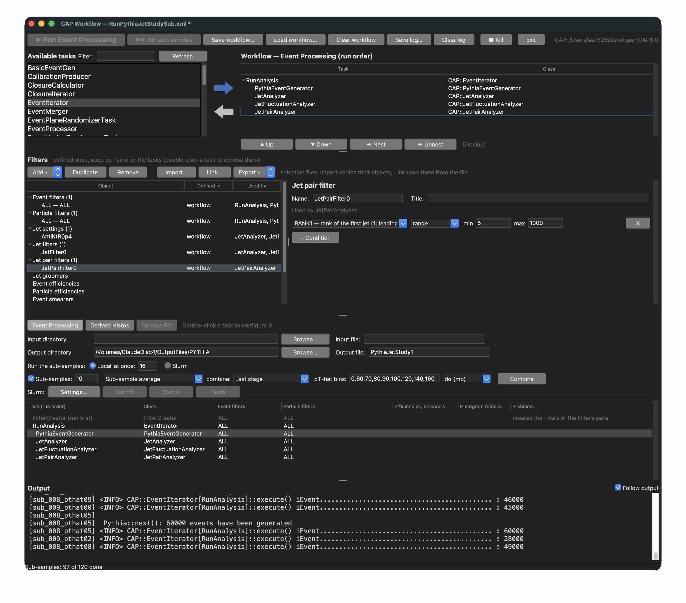

# Running analyses

## Workflows of tasks

An analysis is a **workflow**: a tree of tasks described in an XML file. Typically an event iterator holds a generator
(or a reader of events) and the analyzers that fill histograms from each event; other tasks create the filters, merge
outputs or combine sub-samples. Each task class has an XML **template** (`DB/Templates`) listing its parameters with
their types and defaults; the values of a workflow file are checked against the templates, so that a misspelled or
obsolete parameter is reported when the file is loaded.

## RunDatum.py

`python3 RunDatum.py [workflow.xml]` opens a window in four parts:

- **The workflow editor**: on the left the task classes of the current build, read from their templates; on the
  right the tasks of the workflow, added, removed, ordered and nested (a nested task is a subtask, such as a generator
  inside an event iterator). A task can be added several times, each copy with its own parameters.
- **The filter editor**: the event and particle filters, the efficiencies and the smearers of the workflow, defined
  once by their conditions or parameters (and, for jets, the jet settings, jet filters, jet-pair filters and
  groomers); each task chooses those it uses by name.
- **The task list**: for each task, in the order of execution, the filters it uses, its number of histogram folders
  and the first problem found in its configuration. A double click opens the settings of the task and of its
  histograms (binnings, which folders are created, imported or exported).
- **The output** of the jobs, as they run.

{ .screenshot }

## Filters

**Event filters** select events by class: ranges of multiplicity, energy or an event-shape variable such as spherocity.
**Particle filters** select particles by species and kinematics. An analysis is carried out for every combination of
event and particle filters in the same pass, each combination filling its own folder of histograms
(named after the filters, for example `MB_PiP`).

**Efficiencies** (functions of the kinematics of single particles or of pairs) and **smearers** (resolution and bias
of $p_T$, rapidity and azimuth) reproduce a detector; comparing an analysis of generated particles with the same
analysis of smeared and filtered particles shows the effect of the detector on each observable
([Detector maps](datumgui.md#detector-maps)).

## Stages

A workflow has up to three stages, each run as a job of its own and reading the output of the previous one:

1. **Event processing**: the base histograms are filled event by event.
2. **Derived histograms**: densities, cumulants, correlators, computed from the base histograms with the same filters
   and binnings; `RunDatum.py` makes this stage from the analyzers of the first one.
3. **Balance functions**.

Each stage runs as

```
bin/Datum <stage task> <directory of the workflow>/ <workflow file> <output directory>/
```

which `RunDatum.py --print-command` prints, to run the same job without the window (on a cluster, for instance);
`RunDatum.py --check` checks a file against the templates.

## Sub-samples and clusters

A production can be run in **sub-samples**, on the computer (several at once) or on a **Slurm cluster** (submitted
over `ssh`, with its status and outputs fetched from the window). The sub-samples are combined, with uncertainties
estimated from the sub-sample average or by jackknife. For PYTHIA, the production can be made in bins of
$\hat{p}_T$, combined as differential cross sections in mb or per event of the range covered.

**Run all stages** writes the production in its folder of the output directory, runs or submits its jobs, and
combines them.

## Classes

`Datum::Task`, `Datum::EventIterator`, `Datum::AnalysisTask`, the event and particle filters and the histogram folders of the analyses
([API reference](../api.md)).
